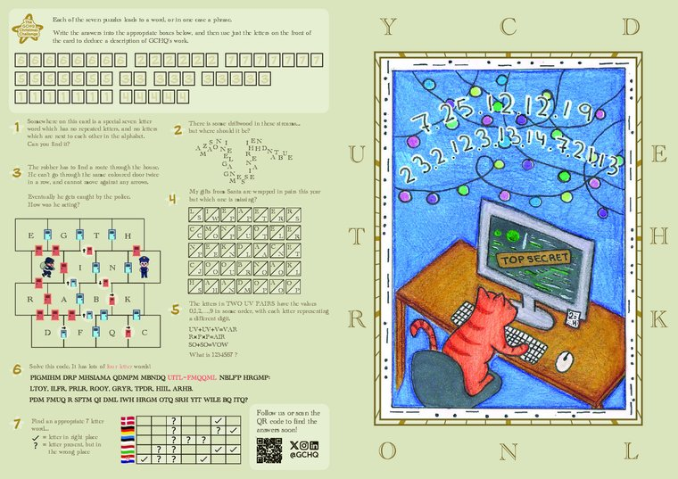
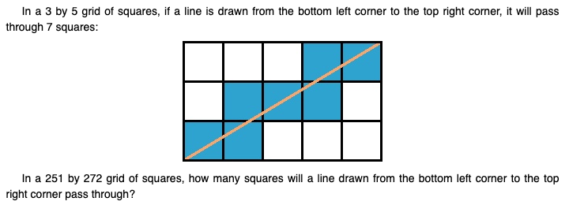
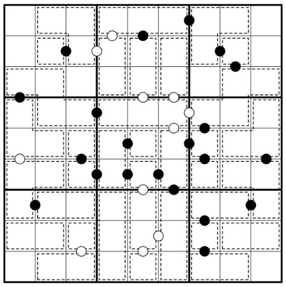
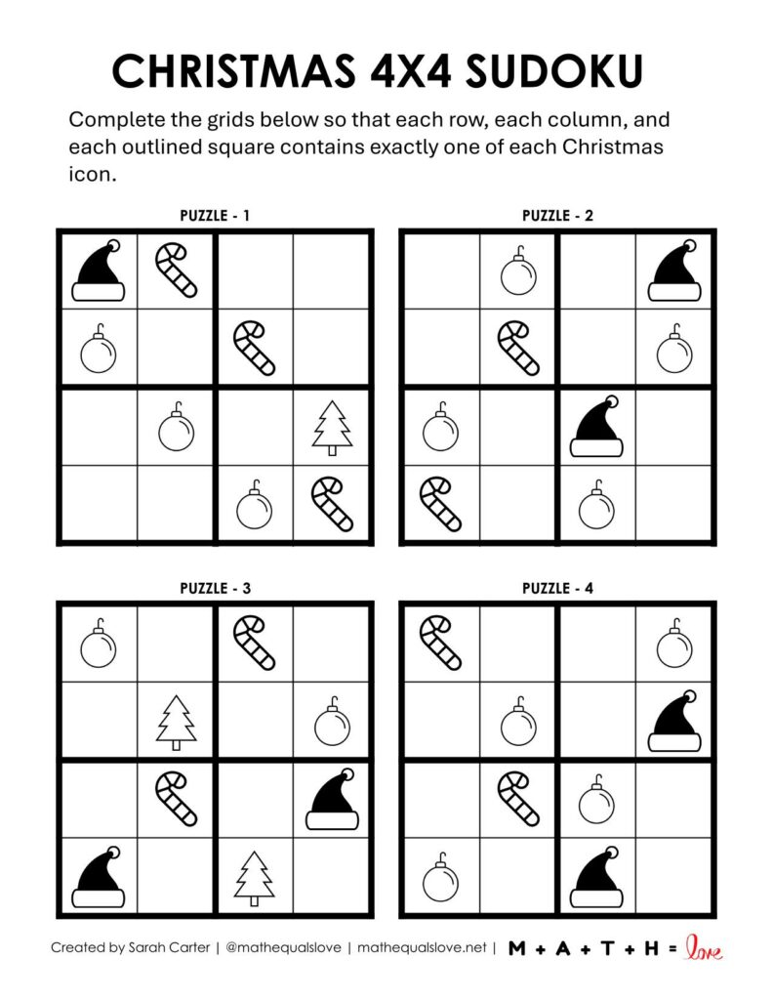
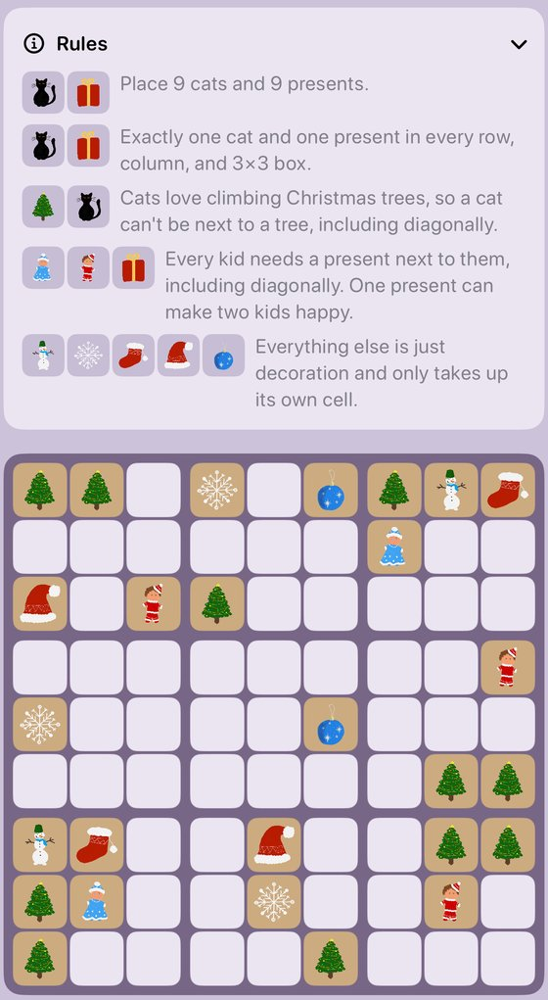

December is the month when it feels so great to wrap yourself in a blanket, grab something warm to drink, and find a cozy hobby to lose yourself in for the whole evening. It's dark outside, but the Christmas vibes are starting to show here and there. One of the best activities for such evenings is puzzles.

Even better, there is a whole category of puzzles that fits the vibe, so I collected some of the best Christmas puzzles for you. Some of them are great for an evening, and some will keep your brain in shape for the whole festive season (hehe). They're all free. Just pick the one that suits you best!

### 1. GCHQ Christmas Challenge (the tough stuff)

GCHQ, the UK's intelligence agency, publishes a Christmas puzzle card every year. Yes, actual spies make it. The 2025 challenge had seven puzzles plus a maths bonus puzzle they called the toughest one so far, and for the first time, schoolchildren designed the card and hid codes in it too.

You download it as a PDF, and there's a hints document for when you're stuck (you will be). Last year it came out on December 10, so keep an eye on [the GCHQ website](https://www.gchq.gov.uk/xmascards) around then.

<figure>
    
    <figcaption>The 2025 card: seven puzzles on the left, one of the schoolchildren's designs on the right. Source: <a href="https://www.gchq.gov.uk/news/gchq-christmas-challenge-2025">GCHQ</a></figcaption>
</figure>

Best for: a team of stubborn adults and a long evening.

### 2. Matthew Scroggs' Advent Calendar (one maths puzzle a day)

Every day in December, a new little maths puzzle opens on [mscroggs.co.uk](https://www.mscroggs.co.uk). Each answer is a three-digit number, and in 2025 the answers helped you put Santa's sleigh back together. The puzzles are short, but some of them are sneaky.

<figure>
    
    <figcaption>Day 9 of 2025: how many squares does the line cross? Screenshot: <a href="https://www.mscroggs.co.uk/puzzles/advent2025/9">mscroggs.co.uk</a></figcaption>
</figure>

Best for: people who are into maths.

### 3. Easy Peasy Sudoku Advent (sudoku variants, for beginners)

If classic sudoku is starting to feel a bit boring, this is a nice way to try something new. In 2025, a puzzle author called Richard ran a sudoku advent calendar on [Logic Masters Germany](https://logic-masters.de), a big portal for sudoku variants. There was a new rule to learn every day, and the puzzles were made for beginners, with a few harder ones closer to Christmas.

He said he's thinking about doing it again, so fingers crossed for this year.

<figure>
    
    <figcaption>Day 3 of 2025: Killer Kropki, a sudoku with dotted cages and black and white dots. Screenshot: <a href="https://logic-masters.de/Raetselportal/Raetsel/zeigen.php?id=000QE0">Logic Masters Germany</a></figcaption>
</figure>

Best for: sudoku players who want to try variants.

### 4. The Confounding Calendar (tiny puzzle games)

This one is a digital advent calendar where every day opens a new tiny puzzle game you can play right in your browser. Different people make the different days, so each one feels a bit different. 2025 was already its fifth year.

You'll find it on [confoundingcalendar.itch.io](https://confoundingcalendar.itch.io/), where the new games show up every day in December.

<figure>
    
    <figcaption>The Ghost of Christmas Present, one of the 2025 games, made in PuzzleScript. Source: <a href="https://wryandbeary.itch.io/the-ghost-of-christmas-present">wryandbeary on itch.io</a></figcaption>
</figure>

Best for: people who prefer moving things around to writing numbers.

### 5. Christmas Picture Sudoku for kids (printable)

Kids can solve sudoku way earlier than you'd think, especially if it uses pictures instead of numbers. [Math = Love](https://mathequalslove.net/category/holidays/christmas) has free printable Christmas sudoku: small 4x4 picture grids for younger kids and 6x6 word sudoku for older ones.

<figure>
    
    <figcaption>4x4 Christmas picture sudoku by Sarah Carter. Source: <a href="https://mathequalslove.net/christmas-sudoku-4x4-puzzles-with-pictures/">Math = Love</a></figcaption>
</figure>

Best for: keeping the kids busy while the adults fight over GCHQ.

### 6. Furdoku Christmas pack (the cozy one)

Okay, this one I made myself, so I'm a bit biased :) Furdoku is a sudoku game with animals instead of numbers, and every pack adds its own special rules.

In the free Christmas pack, every kid needs a present next to them, and cats can't sit next to a Christmas tree (you know why). There are 60 puzzles, from easy to properly hard.

<figure>
    
    <figcaption>A Christmas puzzle in Furdoku, with the rules above the board.</figcaption>
</figure>

Every puzzle has one solution and can be solved with pure logic, and I timed myself on all of them to make sure the difficulty is honest. There are no ads, only the festive vibes.

It's on the [App Store](https://apps.apple.com/app/apple-store/id6825307980?pt=129655037&ct=cozy-corner&mt=8) for iPhone and iPad.

Best for: a quiet evening with a blanket and a cup of something warm.

### Which one should you start with?

If you have one free evening, go for the GCHQ challenge. If you want something small every day, pick one of the advent calendars or Furdoku.

Do you have a favourite Christmas puzzle that's not on this list? Let me know at [hello@frozenbits.se](mailto:hello@frozenbits.se), I'm always looking for new ones. Happy puzzling!
