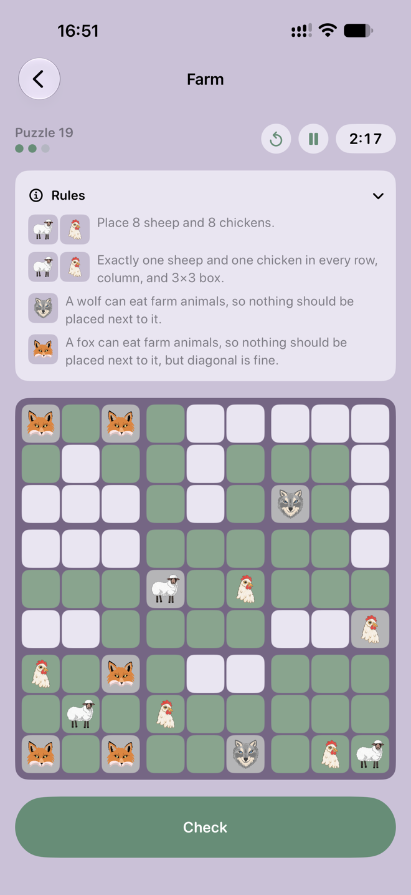
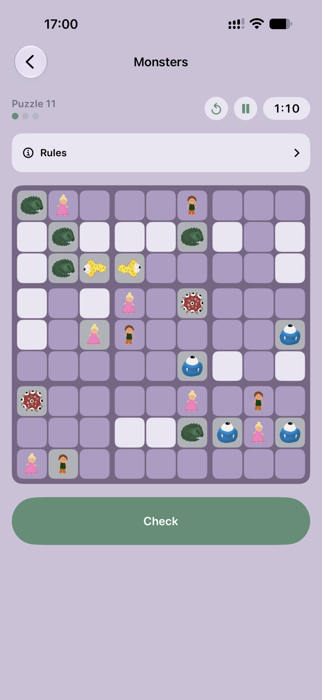
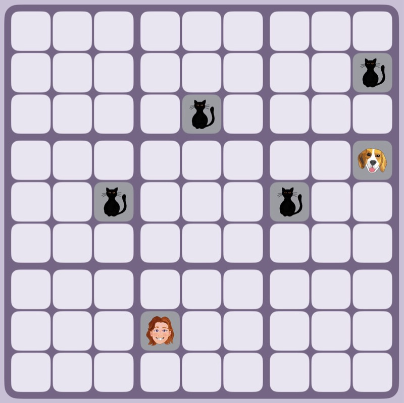
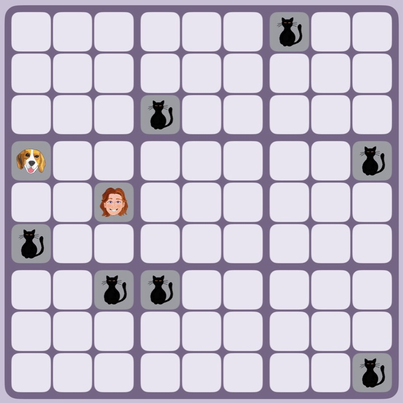
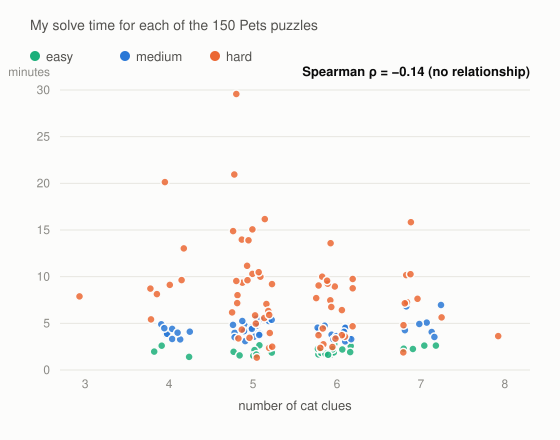
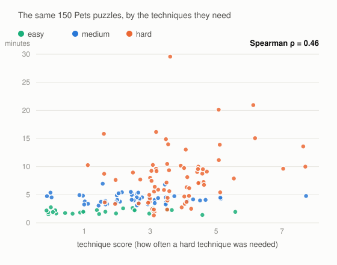
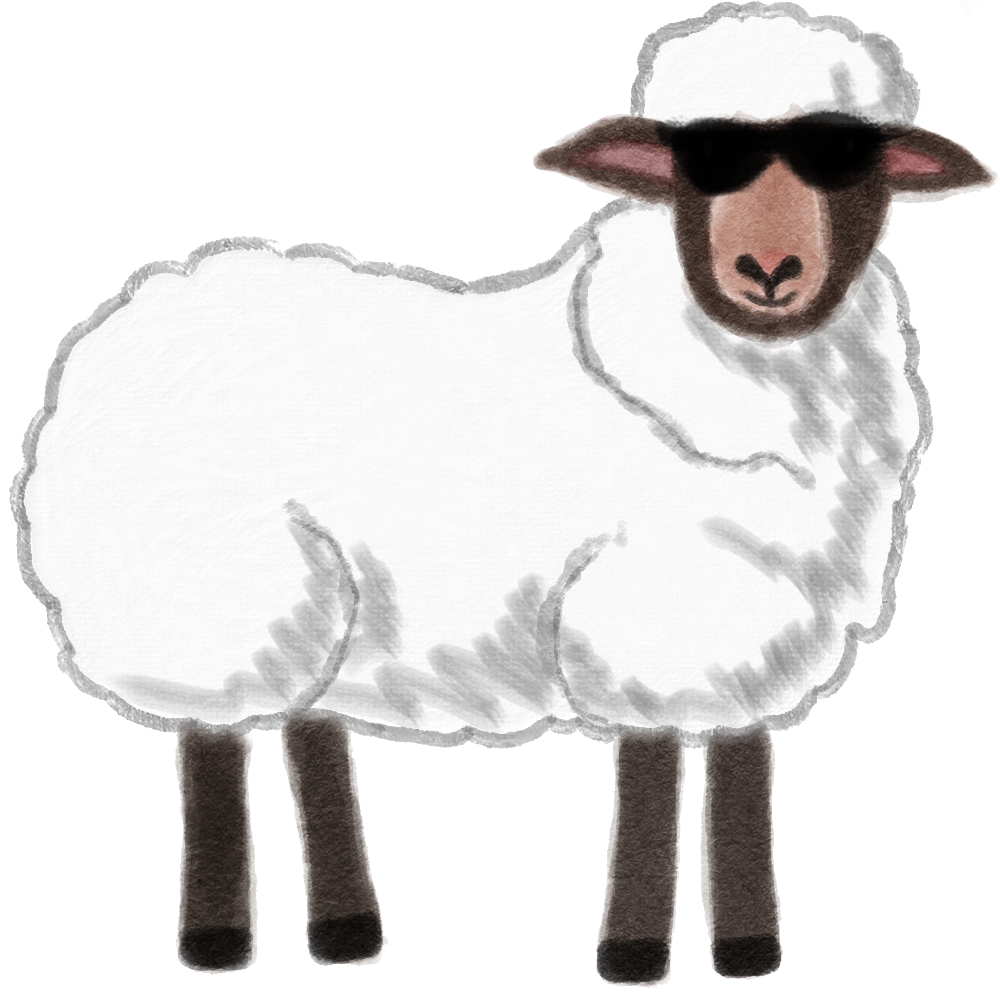

After spending about a month building Furdoku, my first iOS game, I came to a conclusion that didn't surprise me at all: building is never the hardest part. The hardest part is actually making it a product, which involves a range of challenges from design to sales and marketing. Most of my time went into the game design. Since it's a puzzle game, I had to figure out how to make it fun, how to make it easy enough and also hard enough, and how to grade it correctly. With AI, building something from scratch with unfamiliar technology no longer surprises anyone, I believe :) So let me share the actually interesting part of the process.

Let's start with some numbers that made me go "wow" when I learned them. I playtested well over 500 puzzles and spent 50+ hours doing it (yes, it was measured).

You might be wondering: wasn't it possible to automate this work? Was it really necessary to playtest everything? Playtesting helped me gather the data that I could use to calibrate my grading logic.

Some of the tested puzzles didn't make it into the release. I often threw away whole batches because the metrics weren't good enough. I had tons of data, but wasn't using it right. I made loads of mistakes before I got to a reliable grading approach. It turned out to be a really difficult problem, one that AI couldn't solve for me, though it definitely helped a lot.

### What is Furdoku?

Ever since I was a kid, I've enjoyed puzzles like sudoku and Minesweeper. Furdoku is a sudoku variant, where you place entities such as sheep, people, dogs, and chickens, following the sudoku rules, meaning you must put exactly one of each entity in every row, column and 3x3 box. On top of that, there are special rules, for example, you can't place sheep near wolves, or you need to place a dog near a human, otherwise it feels lonely, and so on. Many cells stay empty, which invites new techniques for solving these puzzles, such as checking how many cells are taken in a row/column/box to decide that certain cell is definitely empty (it feels like Minesweeper at times). Marking cells as empty is part of the game, this way you eliminate where none of the entities can be placed and rely on this for the next steps.

Each pack has its own rules and feels like a slightly different game. Some examples:
- **Wolf, Goat & Cabbage:** the old river-crossing riddle in a new form. The wolf eats the goat, the goat eats the cabbage. Place goats and cabbages by sudoku rules, but don't allow anything to get eaten.
todo: instead of monsters mention pets, since it's the major example below
- **Monsters:** each monster looks in its own direction. Place kids on the grid by sudoku rules, but hide them where no monster can see them.

Every puzzle must have exactly one solution, and importantly, you can get to that solution without trial and error. Everything can be solved by logic alone. To ensure that, I have a solver for each pack that solves puzzles like a human would, using techniques, step by step.

Every pack has easy/medium/hard levels, and to determine these levels I needed to build a grader. That was the main challenge. I will talk more about it below.

  
  

### How Furdoku was built

Furdoku is built on my ideas, design, and mechanics. I drew the art for it on my iPad and put a piece of myself into this project. It was implemented using Claude, where I worked with it closely to ensure good code quality and architecture, and made adjustments wherever things looked fishy. Rules and constraints of the puzzles were defined by me, but the puzzles were generated, and they needed quality (solver) and difficulty (grader) evaluation.

I was teaming with Claude very closely while building the grader. A couple of common sudoku techniques are applicable to these puzzles, but they are not exhaustive. So after the basic techniques were covered and the play still felt of a different level than intended, we went through what made puzzles _feel_ hard for me, spotting new techniques, more and more advanced, and incorporating them into our tooling. The prototyping went fast, this was the big strength of AI.

### Fewer clues == harder, right?

The starting point for me was the instinct that the more constraints are visible on the board at the start, the easier it is to solve. I wanted to make sure my metrics were somewhat defensible, so I played the puzzles myself and timed each and every one of them (the app does it for you actually) to judge difficulty based on my timing.

Well, here is the example. You place humans and dogs by sudoku rules. Cats like to be on their own, so nothing should be adjacent to them, dogs get sad if there is no human adjacent. The assumption is that the more cats there are at the start, the easier it is to solve the puzzle.

Which one do you think took me longer to solve?

  
  

The one with fewer clues is done in under 2 min, the one with more clues took 8.
It turned out that the number of clues didn't matter. I expected a graph telling me otherwise, but the data of solving 150 puzzles in this pack showed there was little to no dependency of my timing on the number of clues ([Spearman correlation](https://en.wikipedia.org/wiki/Spearman%27s_rank_correlation_coefficient) = −0.14, where 0 means "no relationship at all").

The same pattern (or the absence of one) showed in different packs with different rules too.

So what actually makes a puzzle hard?

### Putting on the scientist pants

I was sure somebody had already researched it before for sudoku puzzles and, possibly, variants. And indeed, I found Andrew Stuart's [paper on grading sudoku](https://www.sudokuwiki.org/Sudoku_Creation_and_Grading.pdf) that helped me a lot.

The paper lists dozens of solving techniques ordered by their estimated difficulty. Here are some examples of techniques that were applicable to my variant. Let's continue using the Pets pack as an example:

- hidden singles: if a human can go in exactly one place in a given row/column/box, it goes there even if a dog could go there too.
- intersection removal: if a box's dog can only go in one line, that line's dog must be in this box, so no other cell in that line can hold a dog.

On top of these techniques, there were pack-specific techniques, for example a dog needs a human next to it, so the hardest techniques included ruling out where the dog can't go based on where the human can't ever stand around it. There were a couple of techniques based on this dog-human relationship, and they could have different difficulty. To come to the conclusion which technique was hard I had to get stuck a couple of times for a longer time in a puzzle, so that was mostly subjective. Each technique got a weight assigned to it, which was mostly driven by my playtime measurements, the best data I had in my hands.

So, as you remember, the number of clues didn't decide difficulty well. My first improvement was counting 'rounds', where, in a nutshell, you count how many rounds of throwing techniques at the grid it takes to solve a puzzle. The time to rounds correlation looked a bit more promising, but still weak.

The next step was to adopt technique scoring from the paper. It's when you again go in rounds through the puzzle and accumulate the weights of the easiest technique it takes to get to the next step. The graph improved.

Finally, after determining some more of the "custom" techniques, the Spearman score settled at `0.46` for the whole pack.

But that is not the whole story...

### Nuances

Playing it all myself mattered for finding the strange outliers and putting them behind my filter.

Yes, technically it was all solvable by logic, but at some point I found myself holding two hypotheses in my head at the same time before I could place anything, and it felt like trial and error. That's how the sudoku solving algorithms work (backtracking), they try different possibilities that fit until they stumble upon a conflict, and if they do, they go back and try another possibility. A fancier type of bruteforce.

When you find yourself needing a pencil and an eraser to solve sudoku, know that something is wrong. I found myself with a mental pencil writing mental notes, but only one level deep into the possibility tree. Those kinds of puzzles were thrown away.

Hard puzzles are great, but they shouldn't be punishing.

I must say that the grading algorithms I ended up with still couldn't fully consistently correlate with how hard they felt for me.
Part of the reason is that my sudoku variant has at most 2 entities (versus 9 digits in classic sudoku), so many techniques that worked for classic sudoku couldn't apply here.

### Deceived by data

One thing that you might have been shouting in your head throughout this whole post was:
'Girl, your solving skills improved! Time is a bad metric!'.
And you're absolutely right.

My difficulty formula was based on time ranges for solving: < 3 min for easy, >= 3 and < 7 for medium, >= 7 for hard.
I found myself timing 1:29 for a hard puzzle that genuinely felt hard and made me twist my brain a little. Putting it in the easy tier was just wrong.

At the start, each pack was like a new game. I figured out the logical conclusions which felt more like new discoveries. As you proceed with the pack, you start spotting patterns automatically, they don't need discovery, they're familiar already.

So I had to change the way I used my times. At that point I had a lot more trust in my grader, because it was backed by science (yeah, right), so the timing became more of supporting information. The puzzles that only need the easiest techniques go to the easy tier, the ones that need advanced techniques can't go in the easy tier. Outside of that, sort them by my time.

The last pack I made was a Christmas pack (v. 1.0.1), and it's a good illustration. In the final version, the easy puzzles took me slightly longer on average than the medium ones, but they stayed in easy because of the techniques they needed.

It all finally made sense.

### Lessons

In the ideal world with ideal me this would have been a correct approach:
- find research on the matter on day one, don't blindly bump into things;
- involve more people in testing;
- give them smaller batches to avoid their learning curves;
- ask them to write down what were the hardest places (incorporating this data was one of the most important signals that worked for me).

If I am completely honest, I am still not sure that I did it right in the end. If you're willing to <del>supply more data</del> play Furdoku for fun and fun only, [here it is](TODO-app-store-link).

Thank you for reading! I hope you enjoyed it and will come back when I tell you about my next project 👀

  

<!--
REVIEW NOTES (Claude, 2026-11-07). Delete this block before publishing; it doesn't render.

FACTS TO FIX

- fix the todo in packs list
- check the ordering of paragraphs and when the paper should be mentioned in relation to rounds to avoid percention that rounds came after i discovered the paper

FLOW
- The paper/techniques/rounds/scoring part is dense: paper, pack techniques, weights, rounds and
  scoring all arrive in one block. Reordering per fact 3 fixes most of it.
- "The graph improved": give the number here (0.46) or merge with the next paragraph; the reader
  waits two sentences for it.
- "That's how the sudoku solving algorithms work (backtracking)" -> "That's how brute-force
  solvers work". Your own solver works like a human, so the general phrase contradicts the
  "What is Furdoku?" section.
- "Nuances" heading is vague. Something like "Solvable isn't the same as fair" says what's in it.
- Christmas pack claim (easy slower than medium on average): not verified by Claude. Check it
  against your log before publishing.

STILL OPEN (yours): App Store link (TODO-app-store-link)
-->