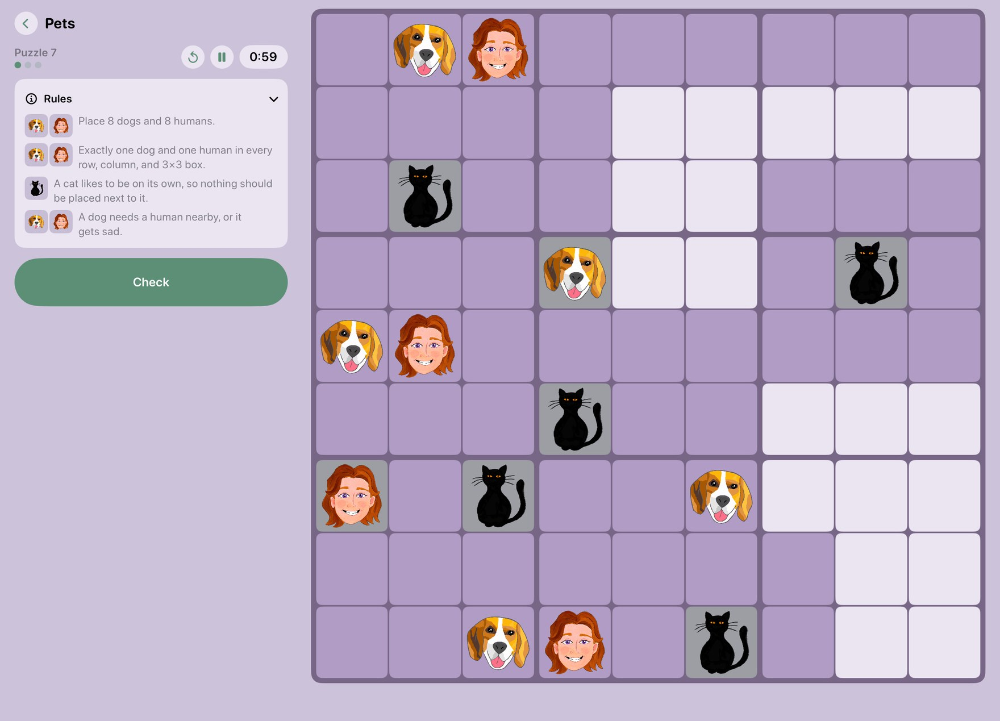
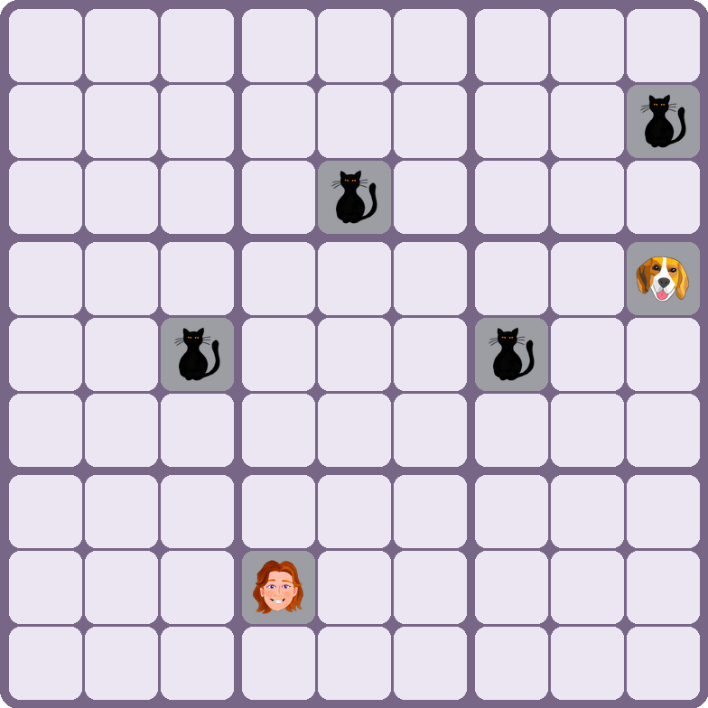
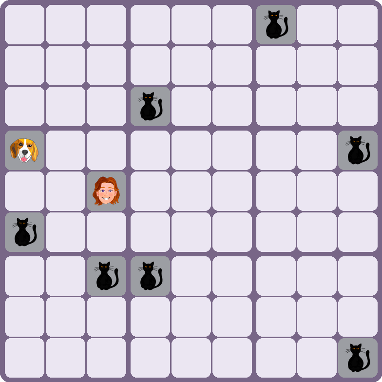
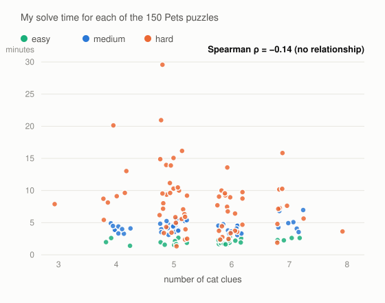
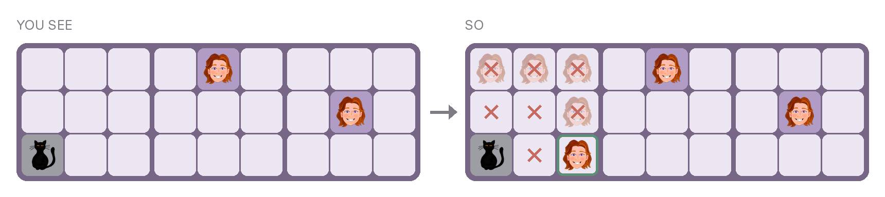
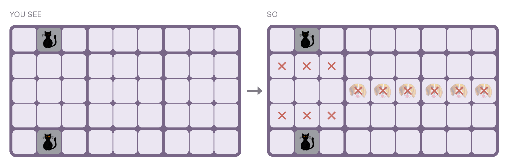
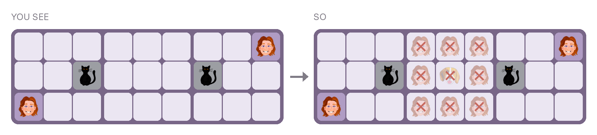
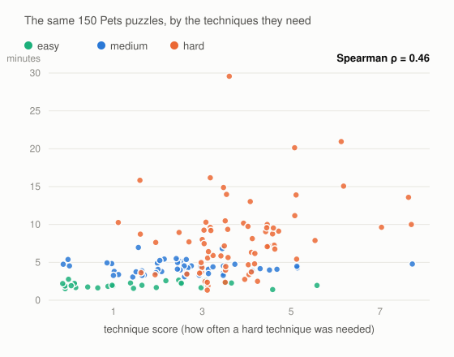
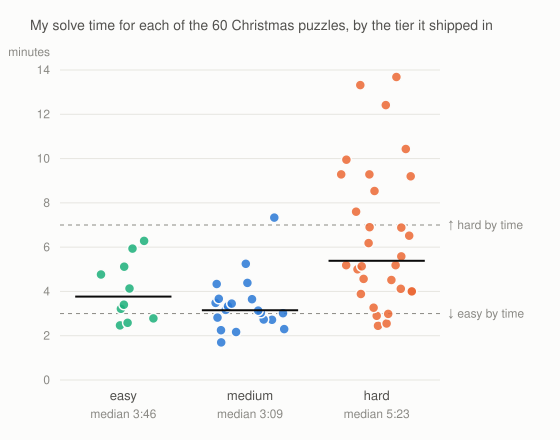
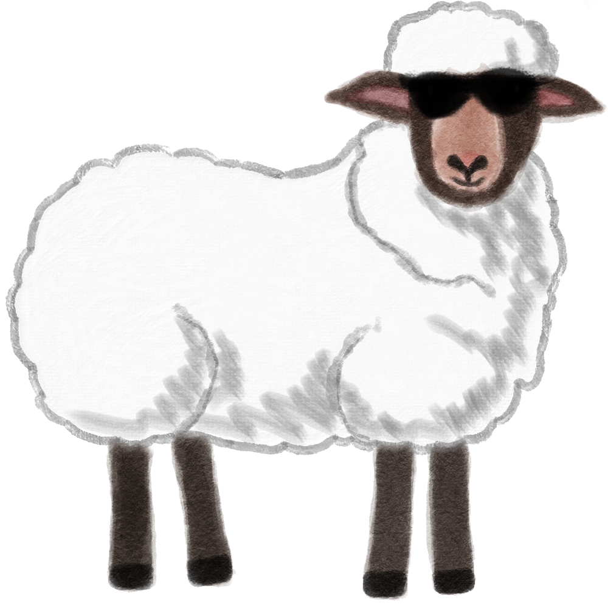

After spending about a month building Furdoku, my first iOS game, I came to a conclusion that didn't surprise me at all: building is never the hardest part. The hardest part is actually making it a product, which involves a range of challenges from design to sales and marketing.

Most of my time went into the game design. Since it's a puzzle game, I had to figure out how to make it fun, how to make it easy enough and also hard enough, and how to grade it correctly. With AI, building something from scratch with unfamiliar technology no longer surprises anyone, I believe :) So let me share the actually interesting part of the process.

Let's start with some numbers that made me go "wow" when I learned them. I playtested well over 500 puzzles and spent 50+ hours doing it (yes, it was measured).

You might be wondering: wasn't it possible to automate this work? Was it really necessary to playtest everything? Playtesting helped me gather the data that I could use to calibrate my grading logic.

Some of the tested puzzles didn't make it into the release. I often threw away whole batches because the metrics weren't good enough. I had tons of data, but wasn't using it right. I made loads of mistakes before I got to a grading approach I could trust. It turned out to be a really difficult problem, one that AI couldn't solve for me, though it definitely helped a lot.

### What is Furdoku?

Ever since I was a kid, I've enjoyed puzzles like sudoku and Minesweeper. Furdoku is a sudoku variant, where you place entities such as sheep, people, dogs, and chickens, following the sudoku rules, meaning you must put exactly one of each entity in every row, column and 3x3 box. On top of that, there are special rules, for example, you can't place sheep near wolves, or you need to place a dog near a human, otherwise it feels lonely, and so on. Many cells stay empty, which invites new techniques for solving these puzzles, such as checking how many cells are taken in a row/column/box to decide that a certain cell is definitely empty (it feels like Minesweeper at times). Marking cells as empty is part of the game: this way you eliminate where none of the entities can be placed and rely on this for the next steps.

Each pack has its own rules and feels like a slightly different game. Some examples:

**Wolf, Goat & Cabbage**: the old river-crossing riddle in a new form. The wolf eats the goat, the goat eats the cabbage. Place goats and cabbages by sudoku rules, but don't allow anything to get eaten.

**Pets**: cats like to be on their own, dogs don't. Place humans and dogs by sudoku rules, but nothing can stand next to a cat, and every dog needs a human next to it.

Every puzzle must have exactly one solution, and importantly, you can get to that solution without trial and error. Everything can be solved by logic alone. To ensure that, I have a solver for each pack that solves puzzles like a human would, using techniques, step by step.

Every pack has easy/medium/hard levels, and to determine these levels I needed to build a grader. That was the main challenge. I will talk more about it below.

### How Furdoku was built

Furdoku is built on my ideas, design, and mechanics. I drew the art for it on my iPad and put a piece of myself into this project. It was implemented using Claude, where I worked with it closely to ensure good code quality and architecture, and made adjustments wherever things looked fishy. Rules and constraints of the puzzles were defined by me, but the puzzles were generated, and they needed quality (solver) and difficulty (grader) evaluation.

I was teaming up with Claude very closely while building the grader. My part was spotting patterns we could incorporate into our tooling, and Claude made it possible to quickly implement them and try out ideas. The prototyping went fast, and that was the big strength of AI.

### Fewer clues == harder, right?

The starting point for me was the instinct that the more constraints are visible on the board at the start, the easier it is to solve. I wanted to make sure my metrics were somewhat defensible, so I played the puzzles myself and timed each and every one of them (the app does it for you actually) to judge difficulty based on my timing.

Well, here is an example from the Pets pack. The assumption is that the more cats there are at the start, the easier it is to solve the puzzle.

Which one do you think took me longer to solve?

  
  

The one with fewer clues took me under `2 min`, the one with more clues took `8 min`.
It turned out that the number of clues didn't matter. I expected a graph telling me otherwise, but the data of solving 150 puzzles in this pack showed there was little to no dependency of my timing on the number of clues ([Spearman correlation](https://en.wikipedia.org/wiki/Spearman%27s_rank_correlation_coefficient) = `−0.14`, where `0` means "no relationship at all").

The same pattern (or the absence of one) showed in different packs with different rules too.

So what actually makes a puzzle hard?

### Putting on the scientist pants

My first improvement was counting 'rounds', where, in a nutshell, you count how many rounds of throwing techniques at the grid it takes to solve a puzzle. You end up counting the steps, but not the difficulty of those steps. The time-to-rounds correlation was better, but still weak.

I was sure somebody had already researched the problem of grading sudoku puzzles, and possibly variants too. And indeed, I found Andrew Stuart's [paper on grading sudoku](https://www.sudokuwiki.org/Sudoku_Creation_and_Grading.pdf), which helped me a lot.

The paper lists dozens of solving techniques, ordered by their estimated difficulty. Here are some of the techniques that were applicable to my variant. Let's continue with the Pets pack as an example:

**Hidden singles**: if a human can go in exactly one place in a given row/column/box, it goes there, even if a dog could go there too.
<figure>
  
</figure>

**Intersection removal**: if a box's dog can only go in one line, that line's dog must be in this box, so no other cell in that line can hold a dog.
<figure>
  
</figure>

On top of these, there were pack-specific techniques. For example, a dog needs a human next to it, so if none of the cells around a spot can hold a human, a dog can't go there.
<figure>
  
</figure>

There were a couple of techniques based on this dog-human relationship, and they weren't equally hard. To figure out which ones were hard, I had to get properly stuck in a puzzle a few times, so that part was mostly subjective. Each technique got a weight assigned to it, mostly driven by my playtime measurements, the best data I had.

The next step was to adopt technique scoring from the paper. In each round, you add the weight of the easiest technique needed to get to the next round. This time, the difficulty of each step actually matters. After incorporating this and identifying some more "custom" techniques, the Spearman correlation settled at `0.46` for the whole pack (not great, not terrible).

But that is not the whole story...

### Nuances

Playing it all myself mattered for finding the strange outliers and filtering them out.

Yes, technically it was all solvable by logic, but at some point I found myself holding two hypotheses in my head at the same time before I could place anything, and it felt like trial and error. That's also the simplest brute-force approach a program can use to get to a solution (backtracking): try different possibilities that fit until you stumble upon a conflict, and if you do, go back and try another possibility.

When you find yourself needing a pencil and an eraser to solve a sudoku, know that something is wrong. I caught myself using a mental pencil to write mental notes, even if only one level deep into the possibility tree. Puzzles like that were thrown away. Hard puzzles are great, but they shouldn't be punishing.

There is one more nuance: my sudoku variant has at most 2 kinds of entities (versus 9 digits in classic sudoku), so many techniques that work for classic sudoku don't apply here. Instead of dozens of techniques, I had a handful to play with, meaning I had less wiggle room for difficulty.

### Deceived by data

One thing you might have been shouting in your head this whole time:
'Girl, your solving skills improved! Time is a bad metric!'
And you're absolutely right.

My difficulty formula was based on time ranges for solving: `< 3 min` for easy, `>= 3` and `< 7` for medium, `>= 7` for hard.
I found myself timing `1:20` for a hard puzzle that genuinely felt hard and made me twist my brain a little. Putting it in the easy tier was just wrong.

At the start, each pack was like a new game. I was working out the logic, and every conclusion felt like a new discovery. As you go through a pack, you start spotting patterns automatically. They don't need discovering anymore, they're already familiar.

So I had to change the way I used my times. At that point I had a lot more trust in my grader, because it was backed by science (yeah, right), so my times became supporting information. The puzzles that only need the easiest techniques go to the easy tier, the ones that need advanced techniques can't go there. Outside of that, sort them by my time.

The last pack I made was a Christmas pack (coming in the next update), and it's a good illustration. In the final version, the easy puzzles took me slightly longer on average than the medium ones, but they stayed in easy because of the techniques they needed.

At least, it looked like it made sense.

### Lessons

In an ideal world, with an ideal me, this would have been the right approach:
- find research on the matter on day one, don't blindly bump into things;
- involve more people in testing;
- give them smaller batches, so their learning curve doesn't skew the times;
- ask them to write down where they got stuck the most (this was one of the signals that worked best for me).

If I am completely honest, I am still not sure that I did it right in the end.

If you're willing to <del>supply more data</del> play Furdoku for fun and fun only, [here it is](https://apps.apple.com/app/apple-store/id6825307980?pt=129655037&ct=blog&mt=8).
If you want to talk about Furdoku, write me at [nataliia@frozenbits.se](mailto:nataliia@frozenbits.se).

Thank you for reading! I hope you enjoyed it and will come back when I tell you about my next project 👀

  

